# AVA Gradius

[](https://github.com/Harlock123/AVAGradius/actions/workflows/build.yml)

A side-scrolling shooter in the style of Konami's 1985 arcade game **Gradius**, built with .NET 10 and
Avalonia UI. The Varkh armada has risen from the deep stars. Fly the starfighter **Halcyon** through four of
their strongholds, build it up from a bare ship with the power gauge, and destroy the **Mind** that drives
them. The ship's computer calls out each power-up in a synthesised voice.

## Features

- **The power gauge:** shoot down a red flier, or a whole line of red fliers, and it leaves a capsule. Each
  capsule lights the next box of the gauge: **SPEED**, **MISSILE**, **TWIN**, **LASER**, **DRONE**,
  **GUARD**. Press the power-up button to take the lit box, or collect more capsules and save up for a better
  one.
  - **Speed** (up to five times) makes the ship quicker.
  - **Missiles** drop onto the ground and run along it, catching the walkers and guns that shots go over.
  - **Twin** adds a shot up and ahead. **Laser** fires a long beam that goes through one thing into the
    next. Taking one replaces the other.
  - **Drones** (up to four) are glowing orbs that follow the path the ship has flown and fire with it.
  - **Guard** is a field in front of the ship that takes ten hits.
- **Four strongholds**, each ending in a fight:
  - **The Fire Ridges:** open space, then ridges with walking guns, turrets and hatches that let out
    fliers, and two volcanoes throwing up boulders. At the end waits **the Bastion**, a battleship whose
    core sits behind plates that must be shot away one by one. Its beams pass harmlessly above and below a
    ship that holds steady in line with the core.
  - **The Glass Reef:** walls of glass to shoot a way through, glass spires sending out drifting rings,
    and a fiercer Bastion.
  - **The Hive:** tunnels of living cells that grow back after they're shot, polyps spitting spores, and
    **the Queen**, whose eye can only be hurt while it's open.
  - **The Citadel:** steel corridors full of guns, shutters to break through, and **the Mind** in its
    chamber behind walls of cells that grow back fast.
- **Like the original, it's hard:** touching rock, glass or cells is the end of the ship, and a lost ship
  starts again at the last checkpoint with nothing but the bare ship. A boss not beaten in time leaves, and
  the stage ends without its points. After the Mind, the armada comes round again, faster.
- **The ship's computer speaks:** it calls out the launch, each power-up, "Hit the core!" when a boss
  arrives, and the end of each stage. The voice comes from a small formant synthesiser in the build
  tools, the way the talking arcade games of the day spoke, so no recording or speech engine is needed.
- **Original music:** a driving stage tune in D minor, a boss theme, a title theme and jingles.
- **The attract mode** shows the computer pilot at work. Every few steps it tries each of the nine ways to
  steer, each followed by a few ways on, on copies of the world, and takes the one that keeps it alive. It
  also lines up with what it can shoot, chases capsules, and takes the power-ups it wants.

## Screenshots

| The title | A red line | The ridges |
|:---------:|:----------:|:----------:|
| 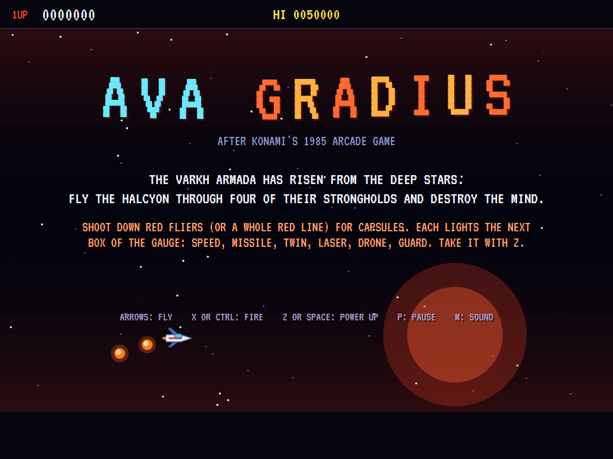 | 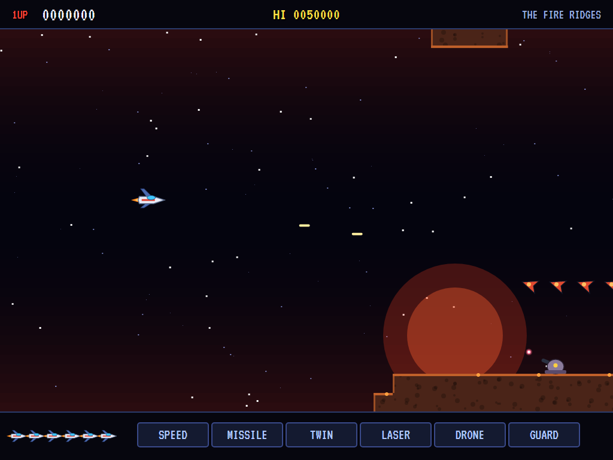 | 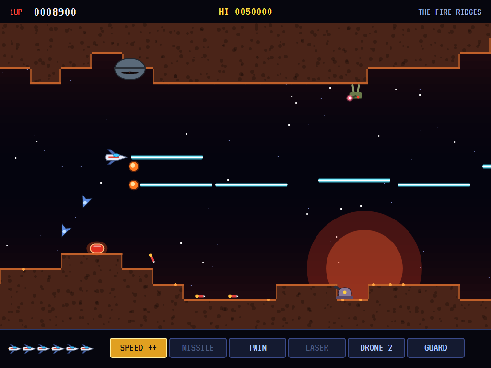 |
| The Halcyon and two drones. | Shoot them all for a capsule. | Lasers, drones, and missiles on the ground. |

| A volcano | The Bastion | The glass reef |
|:---------:|:-----------:|:--------------:|
| 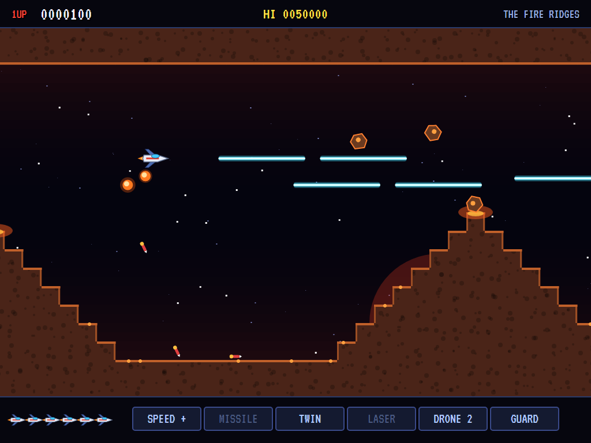 | 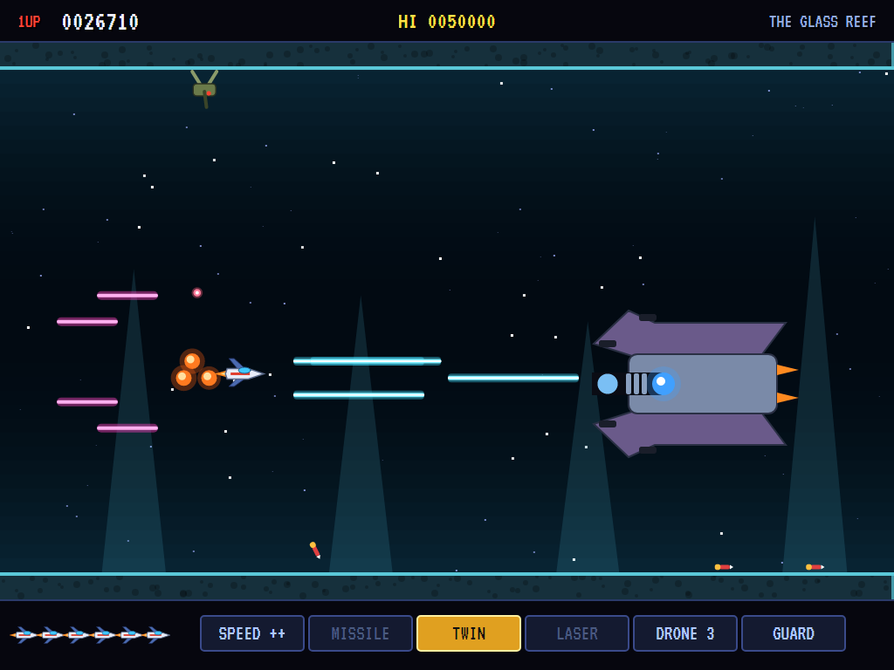 | 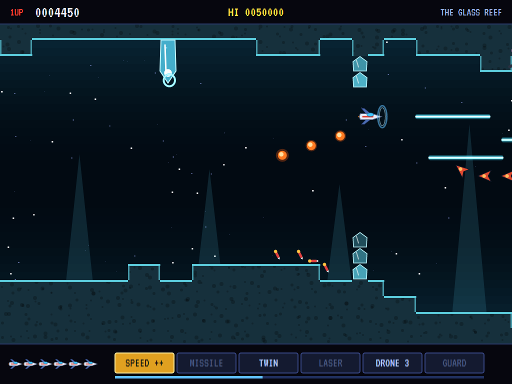 |
| Boulders from the peak. | Its plates, its core, its beams. | Spires, rings, and the guard. |

| The hive | The Queen | The citadel |
|:--------:|:---------:|:-----------:|
| 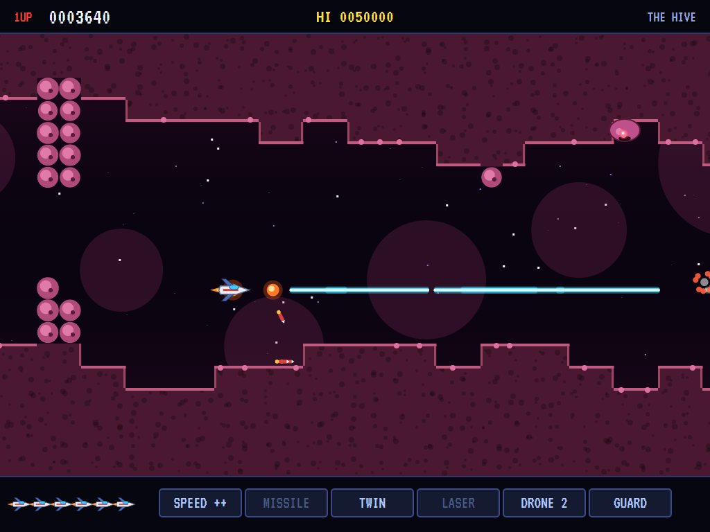 | 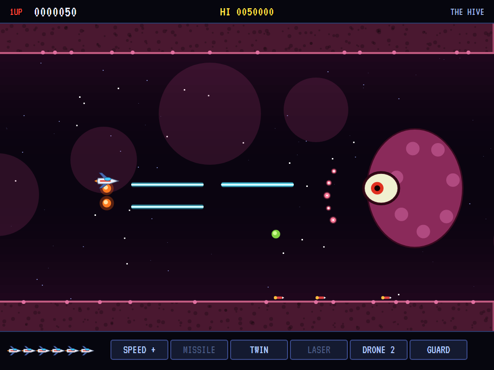 | 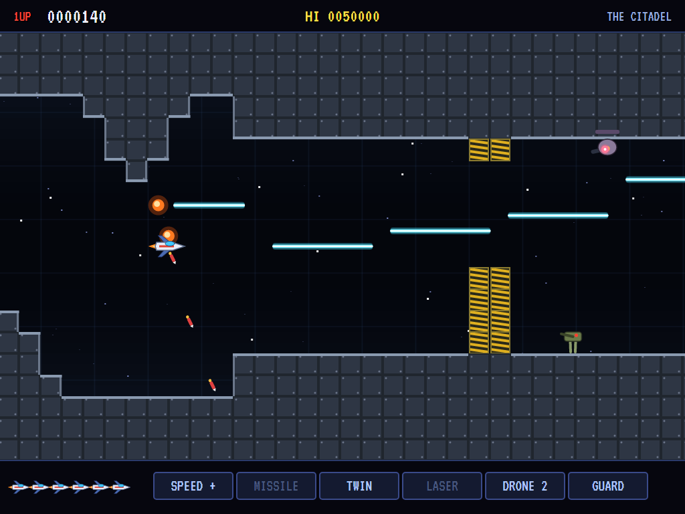 |
| Cells that grow back. | Her eye open. | Shutters and guns. |

| The Mind | Stage clear | The ace pilots |
|:--------:|:-----------:|:--------------:|
| 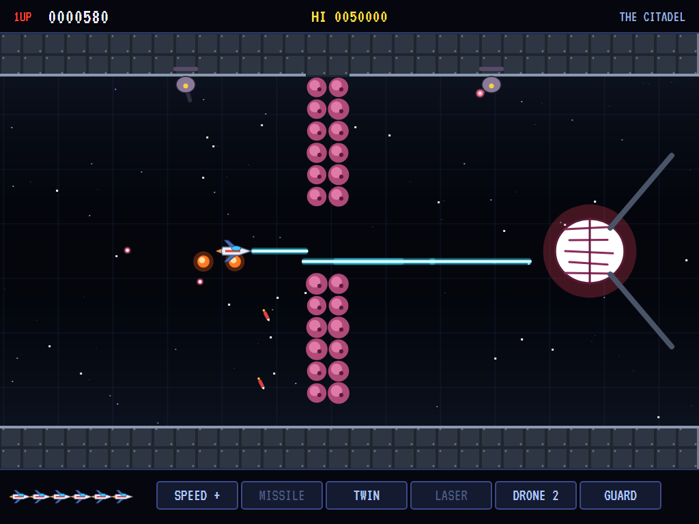 | 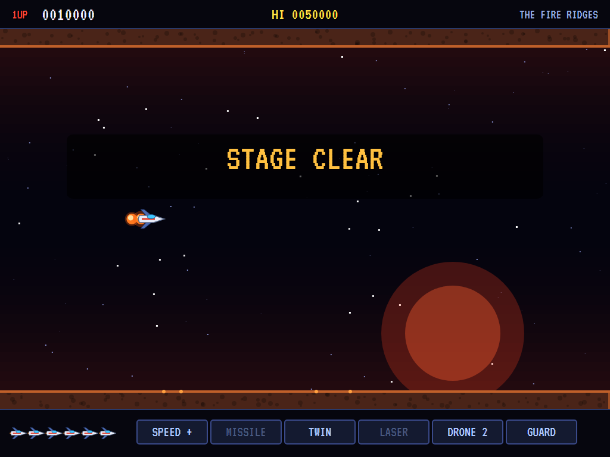 | 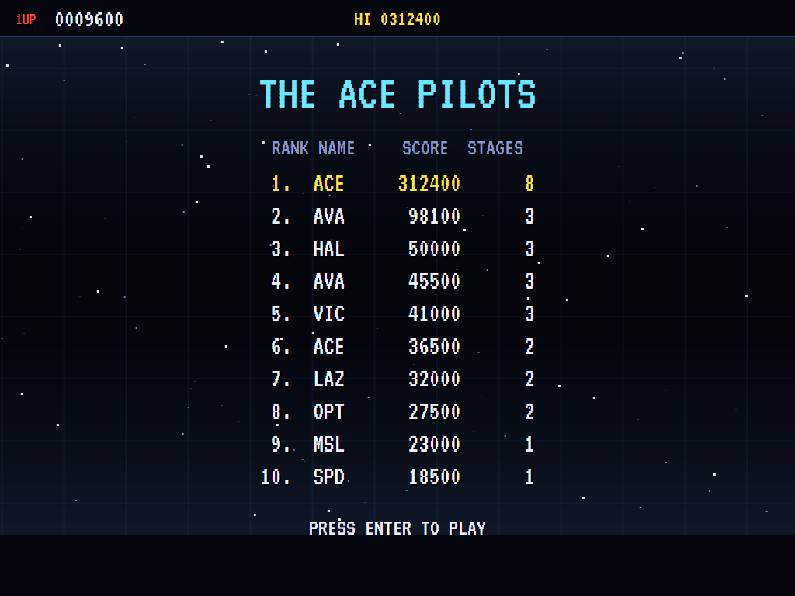 |
| Behind its walls. | The Bastion beaten. | The high-score table. |

The screenshots are made by the tests, which play the game in a real (headless) window; see
[Tests](#tests).

## Download and run

Ready-to-run builds for Windows, macOS and Linux, on both Intel/AMD and ARM, are on the
[Releases page](https://github.com/Harlock123/AVAGradius/releases/tag/latest). **Latest build** is
rebuilt on every push to `main`. Each download is one self-contained executable: no .NET install is
needed.

| Platform | Archive |
|---|---|
| Windows | `AVAGradius-win-x64.zip`, `AVAGradius-win-x86.zip`, `AVAGradius-win-arm64.zip` |
| macOS | `AVAGradius-osx-arm64.tar.gz` (Apple silicon), `AVAGradius-osx-x64.tar.gz` (Intel) |
| Linux | `AVAGradius-linux-x64.tar.gz`, `AVAGradius-linux-arm64.tar.gz`, `AVAGradius-linux-arm.tar.gz` |

```bash
tar -xzf AVAGradius-linux-x64.tar.gz     # or linux-arm64, linux-arm, osx-arm64, osx-x64
./AVAGradius
```

On Windows, unzip and run `AVAGradius.exe`. On macOS, if Gatekeeper refuses to open it, run
`xattr -d com.apple.quarantine AVAGradius` once. Run with `--no-audio` for silence.

**Sound** comes through OpenAL Soft, built in for every platform. In a virtual machine the game
detects it and uses a larger audio buffer, so the sound doesn't break up.

**Gamepads** use SDL2, which is bundled for Windows, macOS and Intel/AMD Linux. ARM Linux builds need it
installed; without it the keyboard still works:

```bash
sudo apt install libsdl2-dev            # Debian / Ubuntu / Raspberry Pi OS
sudo pacman -S --needed sdl2-compat     # Arch / Omarchy
```

## Controls

| Action | Keyboard | Gamepad |
|---|---|---|
| Start | Enter or 1 | Start |
| Fly | Arrows or W/A/S/D | Left stick / D-pad |
| Fire (hold) | X, Ctrl or Shift | B, X or right trigger |
| Power up (take the lit box) | Z or Space | A |
| Pause | P or Esc | Start or Back |
| Sound on/off | M | |
| Screenshot | Ctrl+S (to your Pictures folder) | |

On the high-score table, type your initials, or use up/down and Space, then Enter.

## Tests

```bash
dotnet test AVAGradius.slnx
```

The game runs in fixed 60 Hz steps, so it plays the same at any frame rate. Everything that moves lives in
one world that can be copied, and a copy plays out exactly as the world does (that's tested too). The tests
check:

- **The stages:** there's always a way through at least six rows high that never jumps, the checkpoints
  are clear, the arenas are open, every stage has capsules to win, and the computer pilot clears each one.
- **Flying:** the stage carries the ship, the ship stays on the screen, speed-ups make it quicker, and
  rock is deadly.
- **The guns:** shots two at a time; the laser goes through one thing into the next; the twin fires up and
  ahead; a missile comes down and runs along the ground to a walker; the drones follow the ship's path and
  fire with it.
- **Capsules and the gauge:** a whole red line leaves a capsule, but not if one gets away; capsules move
  the gauge on and round; a box taken can't be taken again; the laser and the twin replace each other; the
  guard wears away.
- **Walls:** glass stays broken and cells grow back; a way shot through a glass wall gets the ship past.
- **The Varkh and the bosses:** guns fire at the ship; hatches let out fliers; volcanoes erupt; the
  Bastion's core is bare only when its plates are gone, and shots off its line glance off; its beams miss a
  ship in line with the core; a boss not beaten in time leaves; the Queen is hurt only with her eye open.
- **The game:** a lost ship starts again at the checkpoint with nothing; the last ship and the high-score
  table; a cleared stage goes on with the ship still armed; the computer pilot flies the whole game round
  to the start again; the demonstration and the high scores; the keys.

`tests/AVAGradius.Tests/PilotProbe.cs` reports how the computer pilot gets on in each stage over several
games, for tuning (`GRADIUS_PROBE=1`; `GRADIUS_PROBE=lazy` for a pilot who only holds the middle and fires).

The screenshot tests draw the real screen in a headless window. To refresh the README's pictures:

```bash
GRADIUS_SHOTS=$PWD/Images dotnet test tests/AVAGradius.Tests --filter ScreenshotTests
```

## Building

```bash
dotnet build AVAGradius.slnx
dotnet run --project src/AVAGradius
```

Needs the .NET 10 SDK. The sounds, the voice and the tunes are made by `tools/make_sounds.py`
(standard-library Python, with `tools/speech.py` for the voice): `python3 tools/make_sounds.py` rewrites
`src/AVAGradius/Sounds`.

## Project structure

```
AVAGradius/
├── AVAGradius.slnx
├── src/AVAGradius/
│   ├── Engine/
│   │   ├── GameEngine.cs        # States, lives, checkpoints, stages in turn, the title and demonstration
│   │   ├── Sim.cs               # A stage step by step: the ship, its guns and drones, the Varkh, the bosses, hits
│   │   ├── World.cs             # Everything that moves, kept together so it can be copied
│   │   ├── Stage.cs             # Squares, how a stage is built, and the four strongholds
│   │   ├── Pilot.cs             # The computer pilot (the demonstration, and the tests)
│   │   ├── HighScoreTable.cs, InitialsEntry.cs
│   │   ├── InputHandler.cs, ControllerManager.cs  # Keys and an SDL2 gamepad
│   │   └── SoundManager.cs      # Effects, the voice and the music through OpenAL
│   ├── Audio/                   # The OpenAL engine (from the author's AVABand)
│   ├── Views/                   # The drawing: the strongholds, the Halcyon, every craft and boss
│   └── Sounds/                  # The synthesised effects, voice and tunes
├── tests/AVAGradius.Tests/      # Stage, gameplay and screenshot tests
├── tools/make_sounds.py, tools/speech.py
└── Images/                      # Screenshots
```

## About and licence

AVA Gradius © 2026 Lonnie Watson, under the [MIT License](LICENSE).

*Gradius* © 1985 Konami; the name belongs to its current owner. AVA Gradius is an independent, unofficial
game in its style. Its ship, its enemies, strongholds and bosses, its graphics, sounds, voice, tunes and code
are its own; nothing is taken from the original game's program, graphics or sound. It is not affiliated with
or endorsed by any rights holder.
